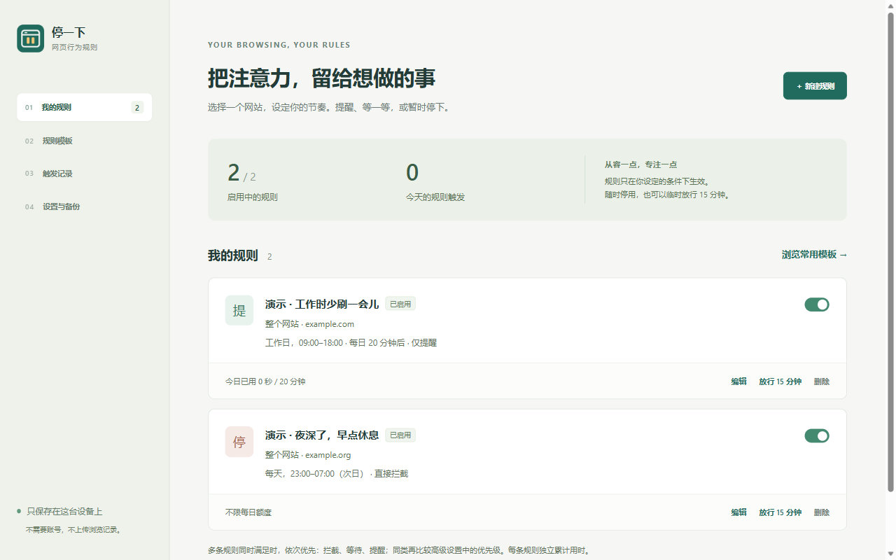
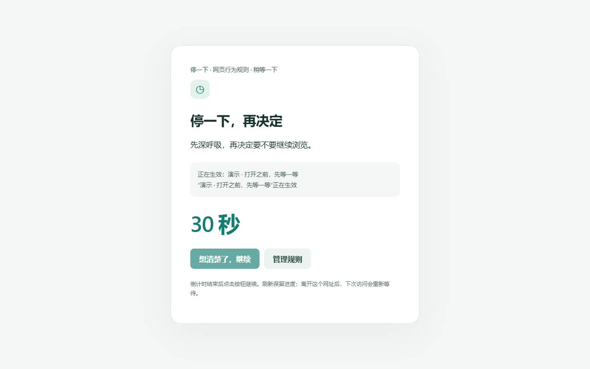

<p align="center">
  
</p>

<h1 align="center">StillTab · 停一下</h1>
<p align="center"><strong>停一下，再决定把时间花在哪里。</strong></p>
<p align="center"><a href="README.md">English</a> · 简体中文</p>

StillTab 是一款帮助你管理浏览习惯的浏览器插件。为经常访问的网站设置提醒、等待倒计时或拦截遮罩，再用时段和每日额度决定规则何时生效。

**Still** 有“静下来”的意思，**Tab** 是浏览器标签页。英文项目名为 **StillTab**，当前中文界面使用 **「停一下 · 网页行为规则」**。插件在本机运行，不需要账号或服务端。



## 能做什么

- **三种处理方式**：仅提醒、等待后放行、直接拦截。
- **不同匹配范围**：整个网站、一段网址路径或具体页面，可添加例外。
- **按时间生效**：选择星期和时段，支持跨午夜。
- **每日浏览额度**：达到额度后，再执行对应的提醒、等待或拦截。
- **临时放行**：单条规则放行 15 分钟，可提前结束。
- **自定义提示**：修改提醒文字和按钮文字，通过模板创建并预览规则。
- **本机管理**：启停规则、查看最近触发记录、导入导出 JSON 配置。

首次安装**没有自动启用的规则**。模板也只有在你主动添加后才会生效。

<details>
<summary>查看等待界面</summary>



</details>

## 从源码安装

准备 **Node.js 20+**、npm 和桌面版 Chromium 浏览器。Manifest 要求 Chrome 120+，Edge 使用同一份 Manifest V3 构建。

下载或克隆仓库，在仓库根目录执行：

```sh
cd apps/extension
npm ci
npm run build
```

1. 打开 `chrome://extensions` 或 `edge://extensions`。
2. 开启**开发者模式**。
3. 点击**加载已解压的扩展程序**，选择仓库内的 `apps/extension/dist`。
4. 将插件固定到工具栏，打开普通 HTTP / HTTPS 网页，创建第一条规则。

构建会生成 manifest、PNG 图标、样式和 JavaScript，输出到 `dist/`；为兼容原有本地安装，也会把运行文件同步到 `apps/extension/`。这些生成文件不提交到 Git。

更新时重新构建，再到扩展管理页点击**重新加载**。重新加载会保留当前本机配置；卸载可能清除配置。

## 先试一条规则

打开一个你经常下意识访问的网站，创建「等待后放行」规则，设置等待 5 秒，不启用时段限制、不设置每日额度。保存后回到网页，等待倒计时结束，再点击继续。之后可以改成「仅提醒」或「直接拦截」。

确认提醒或完成等待后，刷新同一地址不会马上重复触发；离开该地址再返回时可能重新触发。

## 隐私与权限

插件会在本机读取网页地址、活动标签页、窗口焦点和系统锁屏状态，用于匹配规则和累计前台浏览用时。规则、每日用时、临时放行和最近触发记录保存在本机；标签页执行状态保存在会话存储。

- 不需要账号，没有统计上报、广告、云同步或开发者服务器。
- 不抓取网页正文、表单值、消息、图片或音视频内容；等待或拦截时会尝试暂停可找到的媒体元素。
- 触发记录保存来源和路径，不保存查询参数与锚点；主动保存的精确网址规则和会话状态可能包含完整网址。
- 导出的 JSON 只包含规则设置，不包含记录和每日用时。
- 提醒文字和规则名会显示在网页 DOM 中，网站可能读取这些内容，请勿填写秘密信息。

| 权限 | 用途 |
| --- | --- |
| `storage` | 保存本机规则、用时、记录、临时放行及会话状态。 |
| `scripting` | 安装、更新或启动时，向已打开且允许注入的网页加载包内脚本。 |
| `alarms` | 唤醒后台，重新判断时段和临时放行是否到期。 |
| `webNavigation` | 识别单页应用导航和锚点变化，重新判断规则。 |
| `idle` | 锁屏时暂停累计浏览用时。 |
| HTTP / HTTPS 网站权限 | 在用户指定的普通网站上自动执行规则。 |

完整说明见[隐私政策](docs/store/隐私政策.md)。数据不上传，但仍属于插件访问和处理的用户数据。

## 使用边界

- 适合个人自我管理。你可以停用规则、临时放行或卸载插件。
- 拦截通过网页遮罩实现，遮罩出现前网页可能已经加载内容或发送网络请求。
- 不支持浏览器设置页、扩展商店、本地文件等受保护页面。
- 只累计聚焦窗口中符合条件的活动网页用时；后台标签页、等待或拦截状态、锁屏期间不计时。
- 当前界面为简体中文，没有提供 Firefox 或 Safari 版本。
- 仍需更多网站兼容性和长时间运行验证。2026-10-14 的版本通过了 36 项单元测试和 26 项 Edge 浏览器回归；较早一轮计时检查曾失败，重跑通过，但原因未确认。本次发布回归未重新测试 Chrome，详情见[发布包验证](docs/store/发布包验证.md)。

## 本地开发

在 `apps/extension` 下执行：

```sh
npm run typecheck
npm test
npm run build
```

界面使用 TypeScript、HTML 和 CSS；esbuild 打包脚本，Sharp 从 SVG 生成图标，不需要启动应用服务器。

### 浏览器回归

现有 Playwright 脚本按 **Windows 默认 Edge 安装路径**配置。先构建，再运行：

```powershell
npm run test:browser
```

测试会启动独立浏览器配置和本地 HTTP 页面，将结果写入 `work/`，不使用日常浏览器配置。前台计时检查期间请保持测试窗口可用。可以用 `$env:TEST_BROWSER = 'chrome'` 选择 Chrome，但需要匹配脚本内的安装路径，且自动加载扩展是否可用取决于浏览器版本。其他系统需要调整脚本中的可执行文件路径。

### 目录结构

```text
apps/
  extension/
    assets/          图标源文件
    src/core/        规则类型、匹配、时段、额度与校验
    src/runtime.ts   用时计算与页面执行状态
    src/background.ts
    src/content.ts   网页提醒、等待和拦截界面
    src/options.ts   规则管理
    src/popup.ts     当前页状态与快速创建
    scripts/         构建、单元测试及商店图片生成
    tests/           单元测试与浏览器回归
  mobile/            Flutter 手机端及 Android / iOS 平台代码
docs/
  store/             商店文案、隐私政策、截图和上传说明
  mobile/            手机端设计、安装与验证记录
scripts/             本地打包和手机端构建辅助脚本
```

进一步阅读：[开发说明](docs/开发说明.md) · [设计与规则语义](docs/设计与规则语义.md)。

## 手机端源码

仓库还包含 [Flutter 手机端](apps/mobile/README.md)。Android 最低支持 8.0，通过无障碍服务识别应用并显示遮罩；当前本地 APK 是 ARM64 调试包，授权、遮罩和后台存活仍需真机验证。iOS 包含 Screen Time 适配代码，但需要 Mac、相应能力授权、开发者签名和 iPhone 验证，目前没有经过验证的 iOS 发布包。

根目录的手机端 PowerShell 辅助脚本使用作者本机 `D:/code` 工具链路径，不能直接当作通用环境安装脚本。其他开发者应先配置自己的 Flutter 和平台 SDK。

## 参与贡献

欢迎提交范围明确的 Issue 或 Pull Request。反馈问题时，请提供浏览器和系统版本、复现步骤、预期行为及最小规则示例。分享截图或导出配置前，删除个人网址和敏感提示文字。

扩展改动请运行类型检查与单元测试；涉及规则匹配、计时、导航、权限或执行状态时运行浏览器回归。界面修改请附截图。保持数据在本机处理，新增权限时说明必要性。

## 商店发布

当前可从源码构建并本地加载。截至 2026-10-14，Chrome 和 Edge 商店尚未上架。商店资料与操作说明见[上传步骤](docs/store/上传步骤.md)；发布归档在本机生成，不随源码提交。

## 许可证

采用 [MIT](LICENSE) 许可证。第三方依赖保留各自的许可证。
