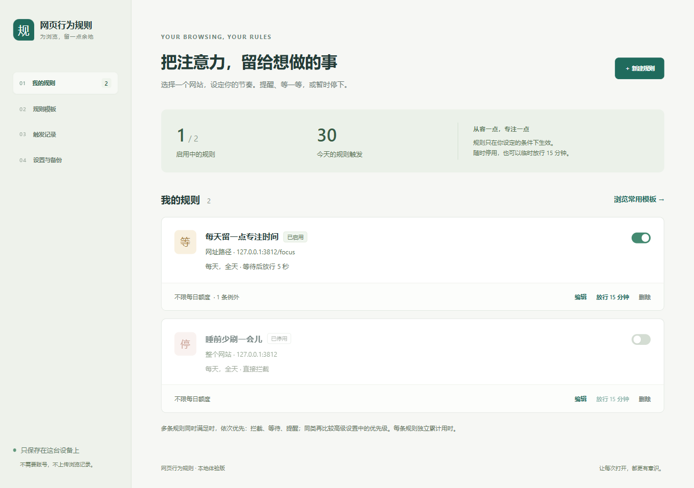
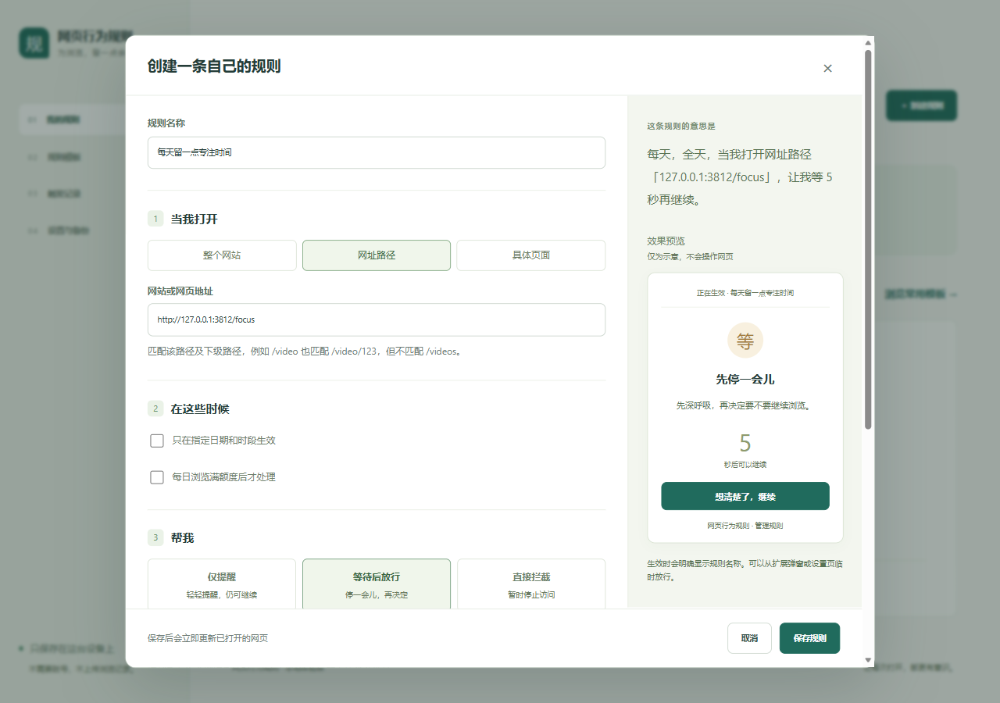
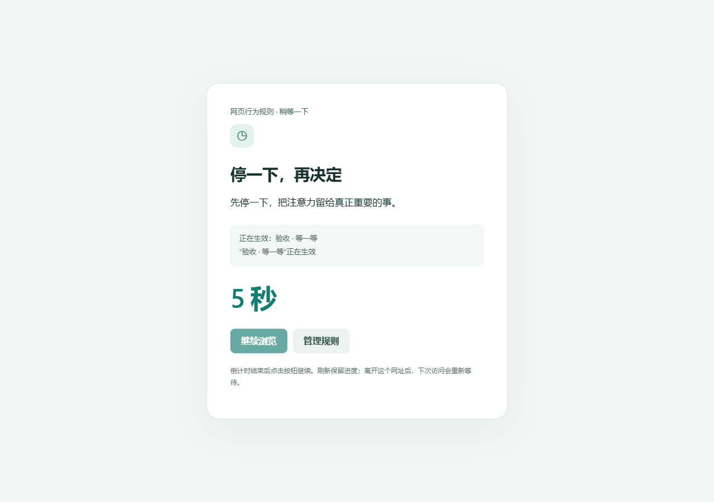
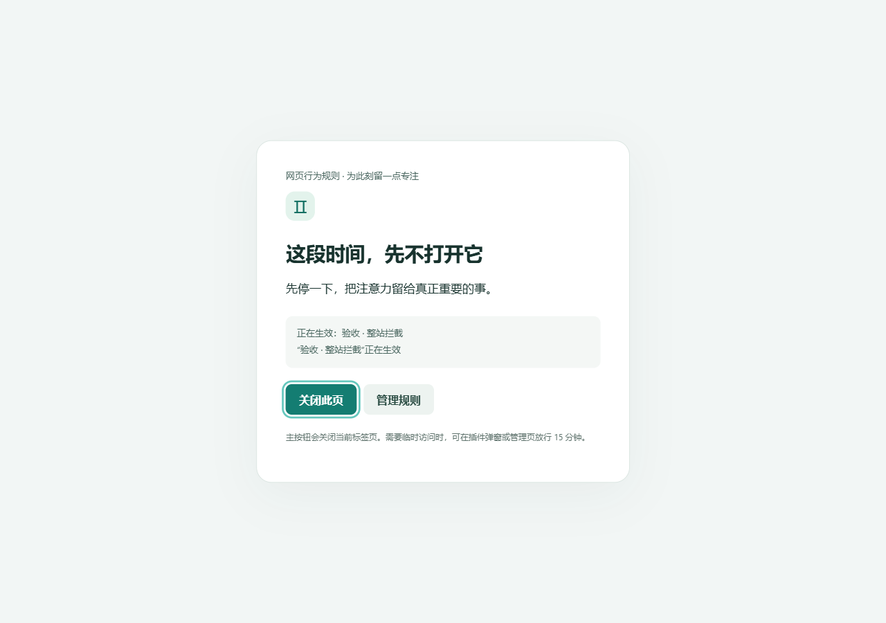

# 验收报告

验收日期：2026-10-14（Asia/Shanghai）。交付范围为本地体验版，没有发布仓库或扩展商店。

## 环境与结论

| 项目 | 实际结果 |
| --- | --- |
| 操作系统 | 本机 Windows |
| Edge | **155.0.4283.45，真实桌面浏览器加载 dist**，完成 25 项端到端检查 |
| Chrome | 检测到 **155.0.8059.39**；自动化启动忽略加载扩展参数，调试协议加载也不可用，**未完成 Chrome 扩展功能验收** |
| 规则与执行状态测试 | **36/36 通过**，含纯函数及真实后台消息队列的模拟 Chrome API 测试 |
| 类型检查 | `npm run typecheck` 通过 |
| 构建 | `npm run build` 通过，dist 包含有效 Manifest V3 与全部本地脚本 |
| 依赖检查 | npm audit：0 个已知漏洞（本次安装时） |

Edge 使用隔离的临时浏览器配置和本地 HTTP 页面，不修改用户日常浏览器配置。Chrome 的自动化加载受限不等同于已证实不兼容；已提供手动“加载已解压的扩展程序”步骤，但不把未实际完成的测试说成通过。

## 实际浏览器验证范围

1. 首装空规则，不影响网页；保存规则立即影响已打开测试页。
2. 网站、路径边界、具体页面、query/hash、例外。
3. 刷新、SPA history 路由及锚点变化，包括同一任务内离开又立即返回。
4. 提醒允许页面继续操作；确认刷新保持、离开网址失效。
5. 等待按钮在到期前禁用，后台拒绝提前确认；到期允许继续。
6. 正在等待时停止服务工作线程，再唤醒，倒计时绝对截止时间保持。
7. 拦截使用模态页面；Esc 不绕过；主按钮真实关闭标签页。
8. 冲突规则按动作级别执行；单条例外不豁免其他规则。
9. 当天全天、未选日期、不在指定时间段的浏览器实际结果。
10. 临时放行、撤回、其他规则继续判断，以及真实经过 1 分钟后自动恢复。
11. 规则修改、启停、删除立即更新网页；日志保存。
12. 损坏导入不覆盖配置、正常 JSON 往返、中文网址持久化重载。
13. 特殊规则 ID（如 toString）不能跳过等待；编码后过长网址在导入时被拒绝。
14. 两标签页及两窗口只累计一份前台用时；后台页不累计。
15. 额度到达时自动拦截，拦截期间不再增加浏览时间。
16. 浏览器关闭重开后，配置、非零用时、日志及未过期临时放行仍在，离线时间不补计。
17. 表单点选保存、自定义文字、例外、句子和效果预览；从等待切为拦截、关闭时段后隐藏字段不阻塞保存。
18. 模板不直接保存；真实下载 JSON、文件导入预览和确认；旧设置页直接导出也读取最新规则。
19. 弹窗读取真实网页状态，快捷创建保留具体页路径/query/hash，自定义入口正确预填。

完整原始记录见 `浏览器验收结果.json`。最后一次代码调整将确认消息绑定到原网页 URL，并在 SPA 地址变化时重新绑定按钮；随后单独复测正常提醒、正常等待（含工作线程恢复）及旧 URL 确认拒绝，结果见 `最终确认回归.json`。完整 25 项与最后 3 项针对性回归分开记录，不混称为对同一版本完整跑了 28 项。

## 计时测量

- 两个匹配标签页存在，前台实测墙钟 3228 ms，累计 3249 ms，差 21 ms 为采样和调用边界开销，没有两倍累计。
- 切到设置页后，原匹配网页后台停留约 2200 ms，增加 **0 ms**。
- 两个浏览器窗口存在，聚焦其中一个，墙钟 2525 ms，累计 2530 ms，没有两窗口叠加。
- 重启前用时 61824 ms，重启后 62147 ms；启动/关闭附近实际浏览增加 323 ms，没有补计约 1.8 秒离线时间。
- 额度阈值测试为避免等待整分钟，向隔离测试数据写入已用 58000 ms，再用真实前台时间跨过 60000 ms；真实一分钟等待另由放行到期测试覆盖。没有把预置时间描述为实际浏览时间。

## 确定性边界测试

单元与后台队列测试涵盖本地午夜分桶、跨午夜归开始日、开始/结束边界、同一日期内时段拆分、每日额度重置、优先级和例外、服务长间隔不补计、恶意/损坏导入、规范化配置的重复读取、UTF-8 2 MiB 容量边界、继承属性 ID、快速导航清除单次放行、旧页面确认不能放行新页面。

这些测试使用指定时间/模拟 API，**没有等待真实午夜，也没有真实更改系统日期或时区**。

## 截图

截图来自真实 Edge，完整图位于 `screenshots`。

### 规则管理

### 句子式编辑与效果预览

### 当前网页弹窗

### 等待和拦截

其余截图包括提醒、模板、配置页。

## 已知限制与未验证项目

- Chrome 功能尚未实测；仅 Edge 完成上述真实验收。未测试其他操作系统或浏览器。
- 拦截是页面遮罩，不能阻止网页网络请求或提供防绕过保证；可能短暂露出原网页。详见设计说明。
- 浏览器内部页、扩展商店、PDF 阅读器等受保护页不适用；无痕模式、跨设备、跨浏览器同步不在本版验收范围。
- 前台计时为约 1 秒采样，高负载、系统休眠或未收到心跳会少计，超过 5 秒的不确定间隔不补计。未实际锁屏、休眠电脑或强制断电做恢复测试；已做服务工作线程终止和正常浏览器重启。
- 未测试真实午夜、夏令时切换、时区/时钟改变、数日连续运行或大量复杂第三方网站兼容性。跨午夜已用确定性测试验证。
- 截图及弹窗功能通过扩展页面读取真实 tabId 验证；未把工具栏弹出窗口的所有浏览器交互作为独立自动化验收。
- 未发布 GitHub、Chrome Web Store 或 Edge Add-ons，也未进行商店审核。
